# EduHub – Lab Angular 28 ngày

Oct 24, 2026 · @Khoa

## Tổng quan

Sau 28 ngày (26/10 – 22/11/2026) bạn có một repo EduHub chạy hoàn toàn trên MSW, gồm shell + 3 micro frontend, catalog SSR, gradebook realtime qua SignalR mock, và bộ test đủ tầng. Mỗi ngày có 4 mục: **Mục tiêu**, **Chú ý**, **Lệnh**, **Xong khi**. Ngày thường khoảng 1–1,5 giờ, thứ Bảy và Chủ nhật 3–4 giờ.

### Phiên bản và công cụ

| Hạng mục | Chọn | Ghi chú |
| --- | --- | --- |
| Angular | v22 (bản mới nhất hiện tại) | App mới từ v21 mặc định zoneless và `ng test` chạy Vitest |
| Workspace | Angular CLI multi-project | Không dùng Nx để schematic của Native Federation chạy thẳng, ít ma sát |
| Node | 22 LTS trở lên | Có `WebSocket` toàn cục, cần cho test SignalR mock |
| Mock API | MSW v2 + `@mswjs/data` | Một bộ handler cho dev, test, SSR, E2E |
| Realtime | `@microsoft/signalr` + MSW `ws.link` | Bọc sau interface `RealtimeClient` |
| State | `@ngrx/signals` (SignalStore) |  |
| Test | Vitest, Testing Library, `TestScheduler`, Playwright, axe |  |
| MFE | `@angular-architects/native-federation` | Cài đúng major với Angular |

### Cấu trúc repo

```text
eduhub/
  projects/
    shell/            host: layout, auth, tenant, routing
    mfe-catalog/      catalog công khai, SSR
    mfe-learning/     khu học sinh
    mfe-admin/        khu giáo viên / admin
    libs/
      ui/ data-access/ auth/ tenant/ util/
      mocks/          handler MSW, db, scenarios, signalr
      testing/        renderWithProviders, helper
  e2e/                Playwright
```

### Kiến trúc tổng

Phần tổng quan có 2 hình, mỗi hình trả lời một câu hỏi. Hình **runtime** cho biết khi app chạy thì ai gọi ai: shell nạp 2 remote qua manifest, catalog là app SSR riêng, mọi HTTP và WebSocket đi vào MSW. Mũi tên vẽ ở mức khối chức năng; chi tiết từng file nằm trong hình của từng ngày.

[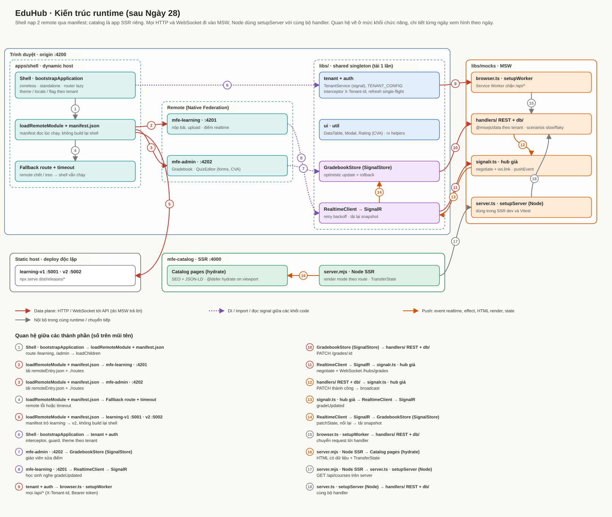](images/eduhub-00-overall.svg)

### Test & CI

Hình thứ hai nối mỗi công cụ test với phần nó kiểm tra. Đây là kim tự tháp test của dự án dưới dạng sơ đồ, dùng để ôn trước phỏng vấn.

[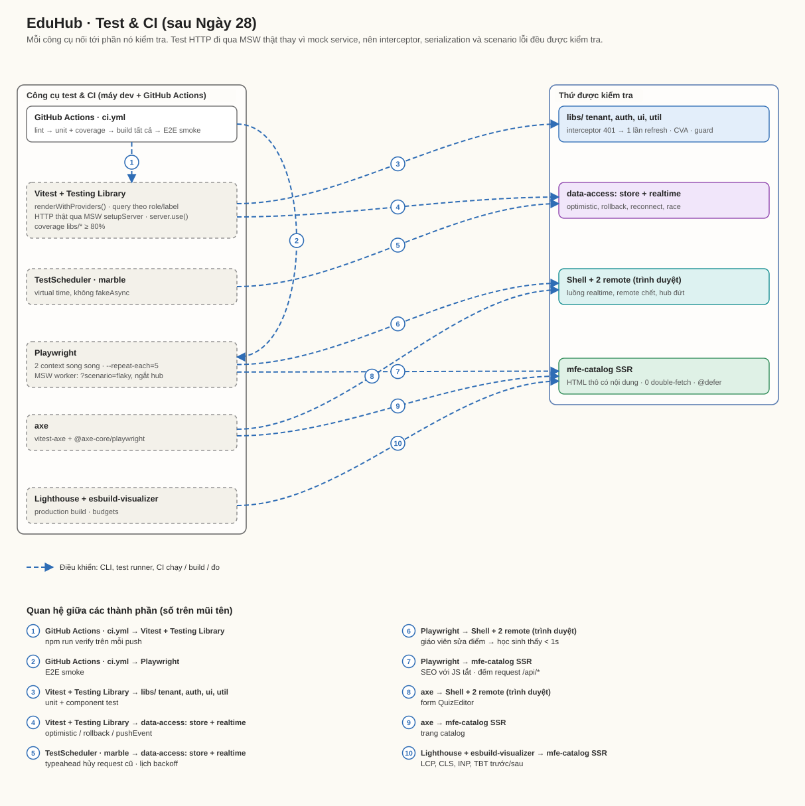](images/eduhub-00-test-ci.svg)

Hình của từng ngày dùng chung một bố cục chi tiết. Khối viền cam là khối thêm trong ngày, nhãn "CẬP NHẬT" và chữ cam là phần mới của khối cũ, còn khối và mũi tên mờ là những thứ đã có từ trước và không đổi trong ngày. Bấm vào hình để xem rõ chữ.

### Quy ước mỗi ngày

- Mở đầu: đọc mục **Mục tiêu** và **Chú ý**, 5 phút.
- Kết thúc: `npm run verify` xanh (lint + test + build), commit theo Conventional Commits.
- Cuối tuần: tag `week-N`, viết 5 dòng retro vào `docs/journal.md`: đã học gì, vấp ở đâu, test nào flaky và vì sao.
- Mọi quyết định có lựa chọn thay thế ghi vào `docs/decisions.md` (ADR ngắn: bối cảnh, lựa chọn, vì sao).

### Ngày 0 – Chuẩn bị (Chủ nhật 25/10, 30 phút)

[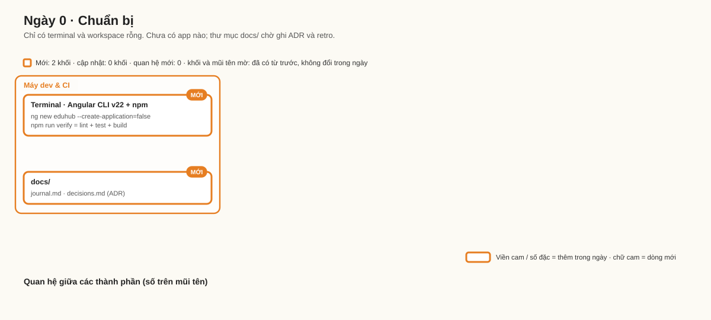](images/eduhub-day00.svg)

**Mục tiêu:** máy sẵn sàng, workspace rỗng, có script `verify`.

**Lệnh:**

```bash
node -v                      # >= 22
npm i -g @angular/cli@22
ng new eduhub --directory ./ --create-application=false --package-manager=npm
cd eduhub
ng add angular-eslint
npm i -D prettier
mkdir -p docs e2e && touch docs/journal.md docs/decisions.md
```

Thêm vào `package.json`:

```json
"scripts": {
  "verify": "ng lint && ng test --no-watch && ng build"
}
```

**Xong khi:** `git log` có commit đầu tiên, repo đã push lên GitHub.

## Tuần 1 – Standalone, Signals, DI + khung MSW và test (26/10 – 1/11)

Cuối tuần: shell chạy hoàn toàn trên MSW, đổi tenant thì theme và dữ liệu đổi theo, CI chạy `lint + test + build`.

### Ngày 1 – Dựng workspace và shell (Thứ Hai 26/10)

[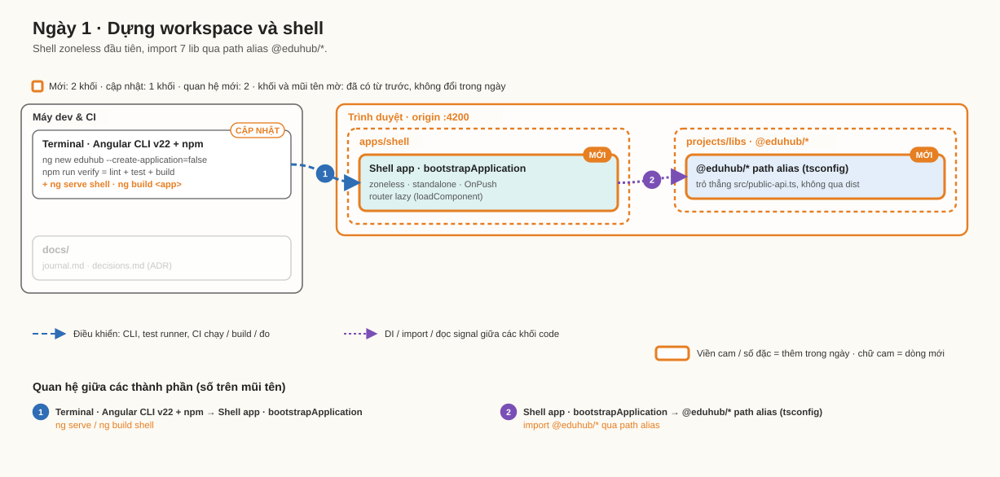](images/eduhub-day01.svg)

**Mục tiêu:** có app `shell` và 7 lib rỗng, import được lib bằng alias.

**Chú ý:**

- `ng g library` mặc định map alias sang `dist/`. Sửa `tsconfig.json` cho alias trỏ thẳng `projects/libs/<lib>/src/public-api.ts` để không phải build lib mỗi lần sửa.
- App mới từ v21 đã zoneless. Kiểm tra `angular.json` không còn `zone.js` trong `polyfills`.
- Đặt prefix khác nhau cho từng lib (`ui`, `auth`…) để lint bắt được selector sai.

**Lệnh:**

```bash
ng g application shell --routing --style=scss --ssr=false
for l in ui data-access auth tenant util mocks testing; do
  ng g library $l --project-root=projects/libs/$l --prefix=$l
done
ng serve shell
```

**Snippet:**

`tsconfig.json` – alias trỏ thẳng vào source (xóa các alias `dist/` do `ng g library` sinh ra):

```json
{
  "compilerOptions": {
    "paths": {
      "@eduhub/ui": ["./projects/libs/ui/src/public-api.ts"],
      "@eduhub/data-access": ["./projects/libs/data-access/src/public-api.ts"],
      "@eduhub/auth": ["./projects/libs/auth/src/public-api.ts"],
      "@eduhub/tenant": ["./projects/libs/tenant/src/public-api.ts"],
      "@eduhub/util": ["./projects/libs/util/src/public-api.ts"],
      "@eduhub/mocks": ["./projects/libs/mocks/src/public-api.ts"],
      "@eduhub/testing": ["./projects/libs/testing/src/public-api.ts"]
    }
  }
}
```

`angular.json` – kiểm tra target build của `shell` không còn `zone.js`:

```json
"polyfills": []
```

`projects/libs/ui/src/lib/ui-button/ui-button.ts` – component mẫu (tạo bằng `ng g component ui-button --project=ui`, selector có prefix `ui`):

```ts
import { ChangeDetectionStrategy, Component, input } from '@angular/core';

@Component({
  selector: 'ui-button',
  template: `<button type="button"><ng-content /> {{ label() }}</button>`,
  changeDetection: ChangeDetectionStrategy.OnPush,
})
export class UiButton {
  label = input('');
}
```

`projects/libs/ui/src/public-api.ts`:

```ts
export * from './lib/ui-button/ui-button';
```

`projects/shell/src/app/app.ts` – import thử từ alias:

```ts
import { Component } from '@angular/core';
import { RouterOutlet } from '@angular/router';
import { UiButton } from '@eduhub/ui';

@Component({
  selector: 'app-root',
  imports: [RouterOutlet, UiButton],
  template: `<ui-button label="Xin chào EduHub" /><router-outlet />`,
})
export class App {}
```

`eslint.config.js` (nếu dùng angular-eslint) – bắt selector sai prefix, ví dụ cho lib `ui`:

```js
{
  files: ['projects/libs/ui/**/*.ts'],
  rules: {
    '@angular-eslint/component-selector': ['error', { type: 'element', prefix: 'ui', style: 'kebab-case' }],
    '@angular-eslint/directive-selector': ['error', { type: 'attribute', prefix: 'ui', style: 'camelCase' }],
  },
}
```

Kiểm tra:

```bash
ng build shell
```

**Xong khi:** `shell` import được một component từ `@eduhub/ui` và `ng build shell` xanh.

### Ngày 2 – MSW: DB giả và handler đầu tiên (Thứ Ba 27/10)

[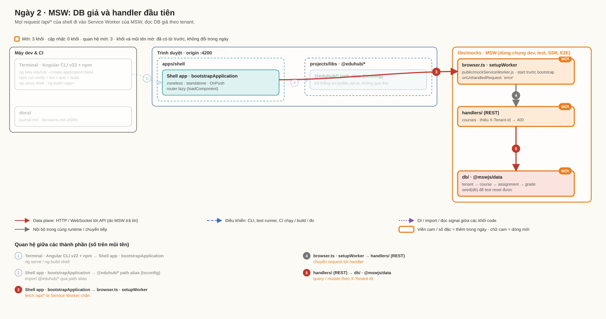](images/eduhub-day02.svg)

**Mục tiêu:** shell gọi `/api/courses` và nhận dữ liệu từ MSW, có 2 tenant `alpha` và `beta`.

**Chú ý:**

- Khởi động worker **trước** `bootstrapApplication` và chỉ khi `isDevMode()`, nếu không request đầu tiên sẽ lọt ra mạng thật.
- Handler đọc `X-Tenant-Id`. Thiếu header thì trả 400 để sau này bắt lỗi interceptor.
- Tách `db/` (dữ liệu) khỏi `handlers/` (HTTP). Seed bằng hàm `seed(db)` để test reset được.
- Đặt `onUnhandledRequest: 'error'` để request chưa mock là lỗi ngay, không âm thầm đi ra ngoài.

**Lệnh:**

```bash
npm i -D msw @mswjs/data @faker-js/faker
npx msw init projects/shell/public --save
# tạo: libs/mocks/src/{db/,handlers/,scenarios/,browser.ts,server.ts}
ng serve shell   # DevTools > Console thấy "[MSW] Mocking enabled"
```

**Snippet:**

`libs/mocks/src/db/index.ts` – DB giả và seed:

```ts
import { factory, primaryKey } from '@mswjs/data';
import { faker } from '@faker-js/faker';

export const db = factory({
  course: {
    id: primaryKey(faker.string.uuid),
    tenantId: String,
    title: String,
  },
});

export function seed(d: typeof db = db) {
  for (const tenantId of ['alpha', 'beta']) {
    for (let i = 0; i < 5; i++) {
      d.course.create({ tenantId, title: `${tenantId} – ${faker.lorem.words(3)}` });
    }
  }
}

export function reset(d: typeof db = db) {
  d.course.deleteMany({ where: {} });
  seed(d);
}
```

`libs/mocks/src/handlers/courses.ts` – handler đọc `X-Tenant-Id`:

```ts
import { http, HttpResponse } from 'msw';
import { db } from '../db';

export const courseHandlers = [
  http.get('/api/courses', ({ request }) => {
    const tenantId = request.headers.get('X-Tenant-Id');
    if (!tenantId) {
      return HttpResponse.json({ message: 'Missing X-Tenant-Id' }, { status: 400 });
    }
    return HttpResponse.json(db.course.findMany({ where: { tenantId: { equals: tenantId } } }));
  }),
];
```

`libs/mocks/src/handlers/index.ts`:

```ts
import { courseHandlers } from './courses';

export const handlers = [...courseHandlers];
```

`libs/mocks/src/browser.ts` và `server.ts`:

```ts
// browser.ts
import { setupWorker } from 'msw/browser';
import { handlers } from './handlers';
export const worker = setupWorker(...handlers);

// server.ts (dùng cho test)
import { setupServer } from 'msw/node';
import { handlers } from './handlers';
export const server = setupServer(...handlers);
```

`libs/mocks/src/public-api.ts`:

```ts
export * from './db';
export * from './handlers';
export { worker } from './browser';
```

`projects/shell/src/main.ts` – khởi động worker trước khi bootstrap:

```ts
import { isDevMode } from '@angular/core';
import { bootstrapApplication } from '@angular/platform-browser';
import { appConfig } from './app/app.config';
import { App } from './app/app';

async function enableMocking(): Promise<void> {
  if (!isDevMode()) return;
  const { worker, seed } = await import('@eduhub/mocks');
  seed();
  await worker.start({ onUnhandledFrame: 'error' });
}

enableMocking()
  .then(() => bootstrapApplication(App, appConfig))
  .catch((err) => console.error(err));
```

`projects/shell/src/app/app.config.ts` – bật `HttpClient`:

```ts
import { provideHttpClient, withFetch } from '@angular/common/http';

export const appConfig: ApplicationConfig = {
  providers: [provideHttpClient(withFetch()) /* ...providers khác */],
};
```

Gọi thử trong `app.ts` (tạm thời, trước khi có interceptor):

```ts
private http = inject(HttpClient);
courses = toSignal(
  this.http.get<{ id: string; title: string }[]>('/api/courses', {
    headers: { 'X-Tenant-Id': 'alpha' },
  }),
);
```

Template: `@for (c of courses(); track c.id) { <li>{{ c.title }}</li> }`

**Xong khi:** tab Network thấy request `/api/courses` được MSW trả về, đổi header tenant thì dữ liệu khác.

### Ngày 3 – Khung test: Vitest + MSW + Testing Library (Thứ Tư 28/10)

[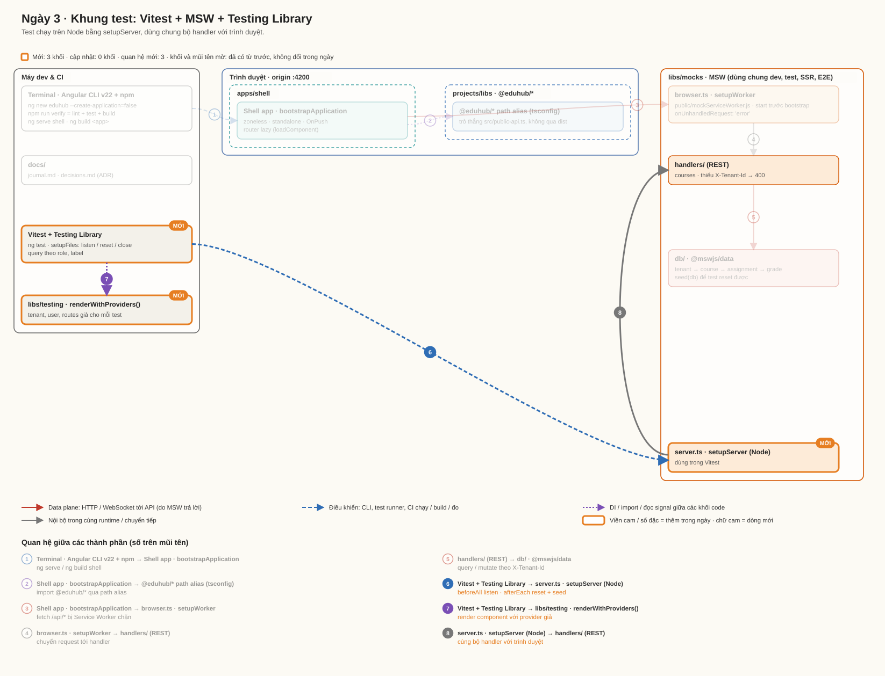](images/eduhub-day03.svg)

**Mục tiêu:** chạy được test component có HTTP thật đi qua MSW `setupServer`.

**Chú ý:**

- `setupFiles` trong target `test` của `angular.json` trỏ tới `test-setup.ts`: `beforeAll(server.listen)`, `afterEach(server.resetHandlers + seed lại db)`, `afterAll(server.close)`.
- Dùng `provideHttpClient(withFetch())` để app và test cùng một đường HTTP.
- `renderWithProviders()` trong `libs/testing` nhận tham số `tenant`, `user`, `routes` để mỗi test chỉ khai báo điều nó quan tâm.

**Lệnh:**

```bash
npm i -D @testing-library/angular @testing-library/user-event @testing-library/jest-dom @vitest/coverage-v8
ng test shell --no-watch
ng test mocks --no-watch
```

**Xong khi:** 1 test render danh sách khóa học từ MSW xanh, và `server.use(...500)` làm test hiện thông báo lỗi.

### Ngày 4 – Signals cốt lõi + TenantService (Thứ Năm 29/10)

[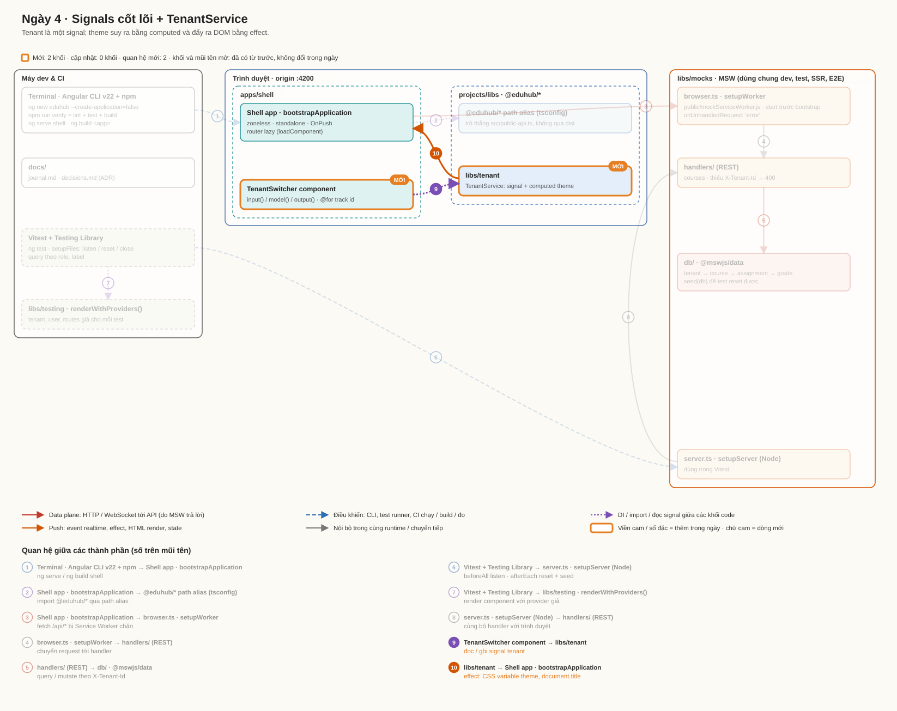](images/eduhub-day04.svg)

**Mục tiêu:** `TenantService` giữ tenant bằng `signal`, theme áp dụng qua `effect`.

**Chú ý:**

- `computed` cho giá trị suy ra (theme, locale, feature flag). `effect` chỉ để đồng bộ ra ngoài (CSS variable, `document.title`), **không** dùng để set signal khác.
- Dùng `input()`, `input.required()`, `model()`, `output()`. Không dùng `@Input()` decorator.
- Control flow `@for` bắt buộc có `track`. Track theo id, không theo `$index`.
- Mọi component đặt `ChangeDetectionStrategy.OnPush`.

**Lệnh:**

```bash
ng g service tenant --project=tenant
ng g component tenant-switcher --project=shell
ng test tenant --no-watch
```

**Xong khi:** test chứng minh đổi tenant thì `computed` theme đổi, và component switcher hoạt động mà không có Zone.js.

### Ngày 5 – DI chuyên sâu (Thứ Sáu 30/10)

[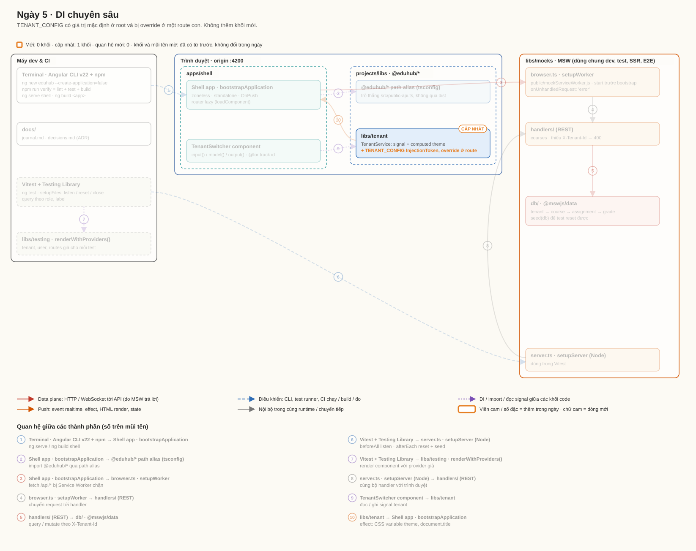](images/eduhub-day05.svg)

**Mục tiêu:** hiểu và chứng minh được injector nào resolve provider nào.

**Chú ý:**

- `TENANT_CONFIG = new InjectionToken(..., { providedIn: 'root', factory })` cho giá trị mặc định, rồi override trong `providers` của một route con.
- `inject()` chỉ chạy trong injection context. Ngoài context thì dùng `runInInjectionContext` hoặc truyền `Injector`.
- So sánh `providedIn: 'root'`, `providers` ở route, `providers` ở component. Ghi lại vòng đời của từng loại.

**Lệnh:**

```bash
ng test tenant --no-watch
```

**Xong khi:** có test chứng minh route `/t/beta/reports` nhận config override, route khác vẫn nhận default. Có 1 ADR về chỗ đặt provider.

### Ngày 6 – Router functional: interceptor, guard, resolver (Thứ Bảy 31/10, 3–4 giờ)

[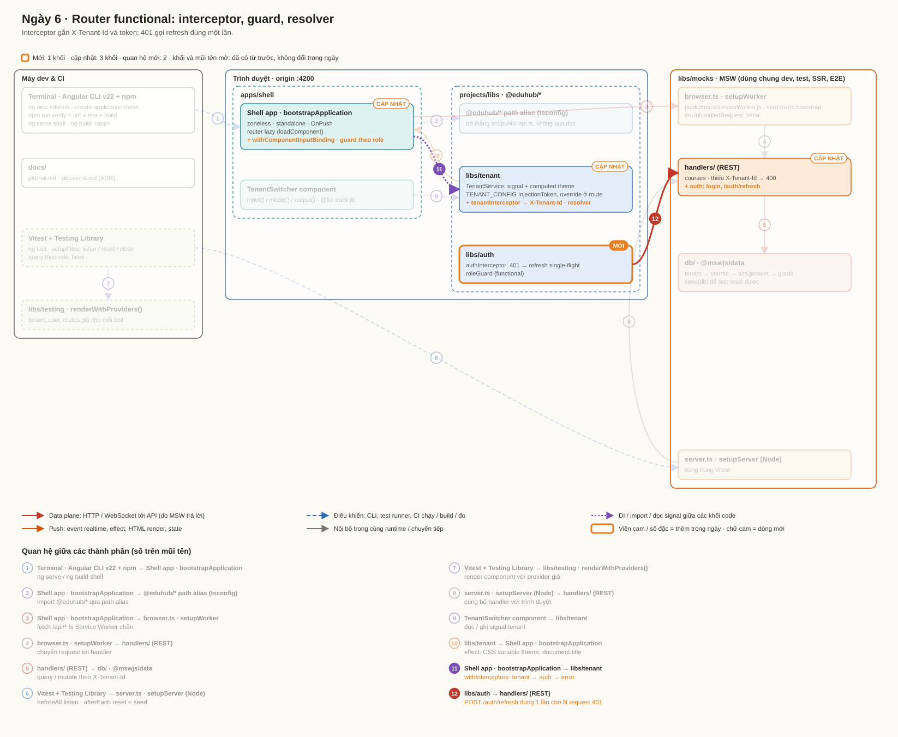](images/eduhub-day06.svg)

**Mục tiêu:** routing lazy, interceptor gắn tenant/token, refresh token khi 401, guard theo role.

**Chú ý:**

- Refresh token phải **single-flight**: 5 request cùng nhận 401 thì chỉ gọi refresh một lần, rồi cả 5 retry. Dùng một `Observable` chia sẻ bằng `shareReplay({ bufferSize: 1, refCount: true })`.
- Không retry request refresh chính nó, tránh vòng lặp vô hạn.
- Bật `withComponentInputBinding()` để param route thành signal input.
- Thứ tự interceptor quan trọng: tenant → auth → error.

**Lệnh:**

```bash
ng g interceptor tenant --project=tenant --functional
ng g interceptor auth --project=auth --functional
ng g guard role --project=auth --functional
ng g resolver tenant --project=tenant --functional
ng test auth --no-watch
```

**Xong khi:** test MSW: (1) mọi request có `X-Tenant-Id`; (2) 3 request đồng thời nhận 401 → đúng 1 lần gọi `/auth/refresh`; (3) guard chặn student vào `/admin`.

### Ngày 7 – UI lib, CI, tổng kết tuần (Chủ nhật 1/11, 3–4 giờ)

[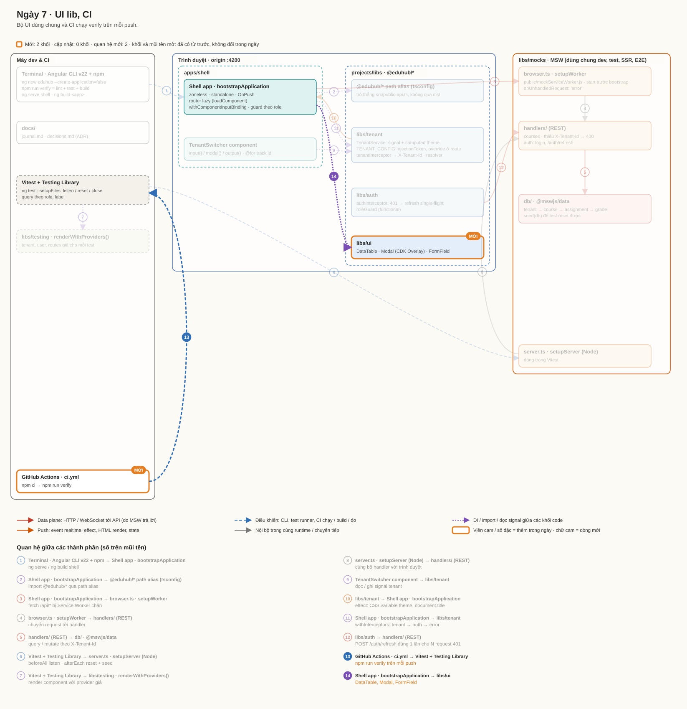](images/eduhub-day07.svg)

**Mục tiêu:** `DataTable`, `Modal`, `FormField` có test, CI chạy trên GitHub Actions.

**Chú ý:**

- `DataTable`: sort, empty state, loading state. Test bằng `getByRole('columnheader')`, không dùng class CSS.
- `Modal` dùng CDK Overlay: focus trap, `Esc` để đóng, trả focus về nút mở.
- CI chỉ cần `npm ci` → `npm run verify`. E2E thêm từ Tuần 3.

**Lệnh:**

```bash
ng add @angular/cdk
ng g component data-table --project=ui
ng g component modal --project=ui
ng test ui --no-watch --coverage
mkdir -p .github/workflows   # tạo ci.yml
git tag week-1 && git push --tags
```

**Xong khi:** CI xanh, coverage `ui` ≥ 80%, đã viết retro tuần 1.

## Tuần 2 – RxJS, Signals, SignalStore, SignalR mock (2/11 – 8/11)

Cuối tuần: học sinh nhận điểm realtime qua SignalR (mock bằng MSW), giáo viên sửa điểm có optimistic update và rollback, không còn `subscribe()` thủ công trong component.

Từ tuần này đến hết Tuần 3, feature đặt trong `projects/shell/src/app/features/<khu>` (catalog, learning, admin), logic dùng chung đặt trong `libs/`. Tuần 4 sẽ tách mỗi thư mục `features/<khu>` thành một remote, nên giữ chúng không import chéo nhau ngay từ đầu.

### Ngày 8 – Ôn flattening operators bằng marble (Thứ Hai 2/11)

[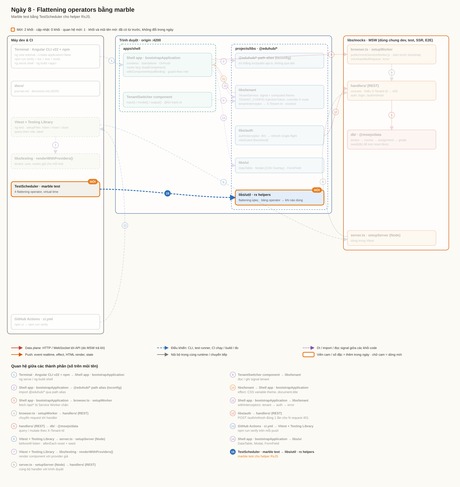](images/eduhub-day08.svg)

**Mục tiêu:** tự giải thích được khác biệt `switchMap`, `mergeMap`, `concatMap`, `exhaustMap` bằng 4 marble test.

**Chú ý:**

- Dùng cùng một input marble cho cả 4 operator, chỉ đổi operator. Nhìn output khác nhau là hiểu ngay.
- `TestScheduler` chạy virtual time. Đừng dùng `setTimeout` hay `fakeAsync` trong marble test.
- Ghi bảng "operator → khi nào dùng → ví dụ trong EduHub" vào `docs/journal.md`.

**Lệnh:**

```bash
# libs/util/src/rx/flattening.spec.ts
ng test util --no-watch
```

**Xong khi:** 4 marble test xanh và bảng so sánh có ví dụ thật: tìm kiếm, upload, lưu theo thứ tự, nộp bài.

### Ngày 9 – Typeahead tìm khóa học (Thứ Ba 3/11)

[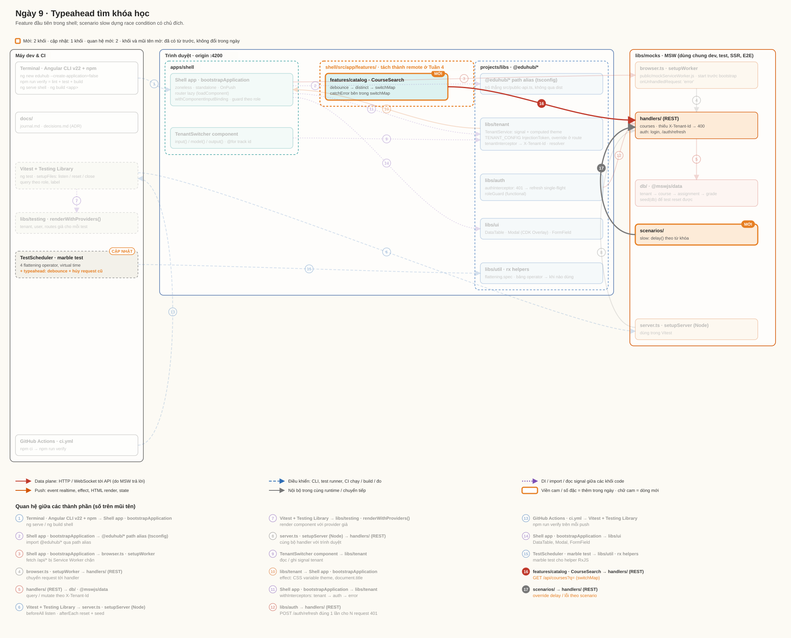](images/eduhub-day09.svg)

**Mục tiêu:** ô tìm kiếm có `debounceTime` → `distinctUntilChanged` → `switchMap`, đủ 4 trạng thái loading/error/empty/data.

**Chú ý:**

- `catchError` phải đặt **bên trong** `switchMap`. Đặt bên ngoài thì một lỗi sẽ giết cả stream, ô tìm kiếm chết luôn.
- Gom trạng thái thành một kiểu `{ status, data, error }` rồi `toSignal`, template chỉ đọc signal.
- Handler MSW dùng `delay()` theo từ khóa để dựng race condition có chủ đích.

**Lệnh:**

```bash
ng g component features/catalog/course-search --project=shell
ng test data-access --no-watch
```

**Xong khi:** (1) marble test debounce + hủy request cũ; (2) test MSW gõ "ang" (chậm 800ms) rồi "rxjs" (nhanh 100ms), kết quả cuối là "rxjs"; (3) server trả 500 một lần, gõ tiếp vẫn tìm được.

### Ngày 10 – Nộp bài và upload (Thứ Tư 4/11)

[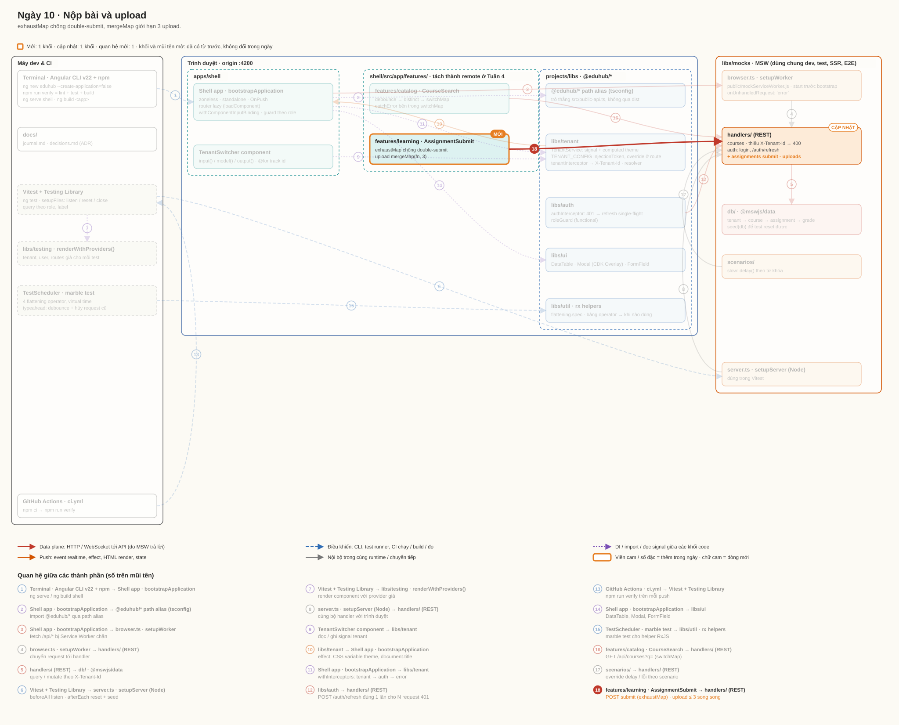](images/eduhub-day10.svg)

**Mục tiêu:** nộp bài chống double-submit bằng `exhaustMap`, upload nhiều file song song tối đa 3.

**Chú ý:**

- `mergeMap(fn, 3)` giới hạn concurrency. Kiểm tra bằng cách đếm request đang chạy trong handler MSW.
- Không `subscribe()` trong component: dùng `rxMethod` của `@ngrx/signals` hoặc `outputToObservable` + `toSignal`.
- `takeUntilDestroyed()` chỉ cần khi buộc phải subscribe tay, ghi lý do vào code.

**Lệnh:**

```bash
npm i @ngrx/signals
ng g component features/learning/assignment-submit --project=shell
ng test --no-watch
```

**Xong khi:** test click "Nộp" 5 lần nhanh → đúng 1 POST; upload 7 file → không lúc nào có quá 3 request đồng thời.

### Ngày 11 – Interop Signals ↔ RxJS (Thứ Năm 5/11)

[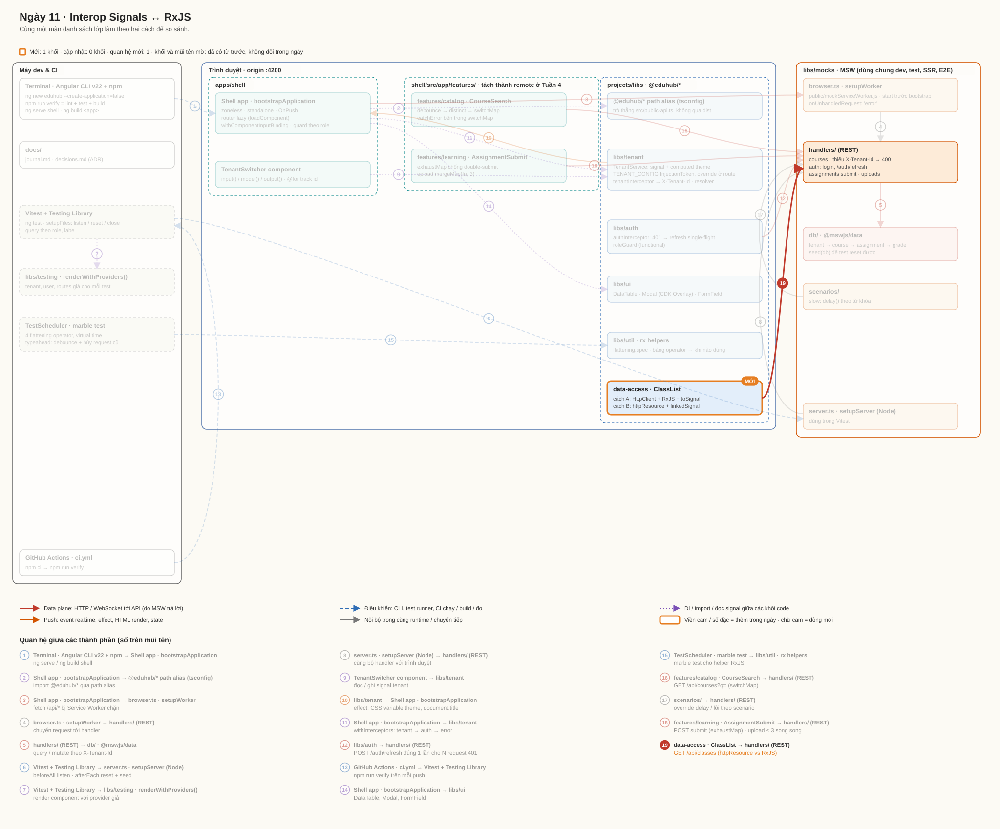](images/eduhub-day11.svg)

**Mục tiêu:** làm cùng một màn danh sách lớp học theo 2 cách và viết được khi nào chọn cách nào.

**Chú ý:**

- Cách A: `HttpClient` + RxJS + `toSignal`. Cách B: `httpResource` (reactive theo signal params) + `linkedSignal` cho trang hiện tại.
- `toSignal` cần `initialValue` hoặc chấp nhận `undefined`. `requireSync` chỉ dùng khi source phát đồng bộ.
- `linkedSignal`: reset trang về 1 khi đổi bộ lọc, nhưng người dùng vẫn đổi trang được.
- `httpResource` hợp với GET phụ thuộc tham số; RxJS vẫn mạnh hơn cho luồng phức tạp (retry, debounce, websocket).

**Lệnh:**

```bash
ng test data-access --no-watch
```

**Xong khi:** cả 2 cách có test giống nhau và cùng xanh; có 1 ADR "httpResource vs RxJS".

### Ngày 12 – Gradebook SignalStore (Thứ Sáu 6/11)

[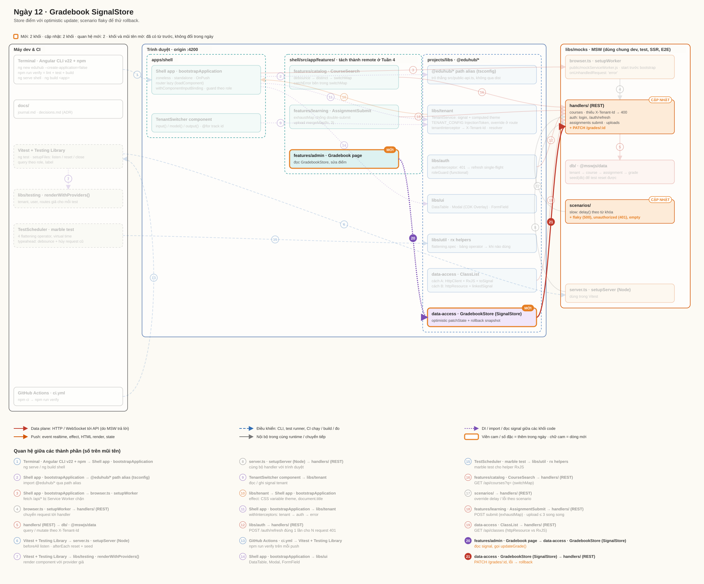](images/eduhub-day12.svg)

**Mục tiêu:** store điểm có `withState`, `withComputed`, `withMethods`, optimistic update và rollback.

**Chú ý:**

- Optimistic: `patchState` ngay, giữ snapshot cũ, gọi API; lỗi thì `patchState(snapshot)` và báo lỗi.
- Hai lần sửa cùng một ô liên tiếp: lần 1 lỗi không được ghi đè kết quả lần 2. Dùng `concatMap` theo từng ô hoặc so version.
- Store nhận API qua DI để test có thể thay bằng MSW, không mock service.

**Lệnh:**

```bash
# libs/data-access/src/gradebook/gradebook.store.ts
ng test data-access --no-watch --coverage
```

**Xong khi:** test (1) sửa điểm → UI đổi ngay trước khi API trả; (2) `server.use(http.patch(..., () => HttpResponse.error()))` → điểm quay lại giá trị cũ và có thông báo.

### Ngày 13 – SignalR mock bằng MSW (Thứ Bảy 7/11, 3–4 giờ)

[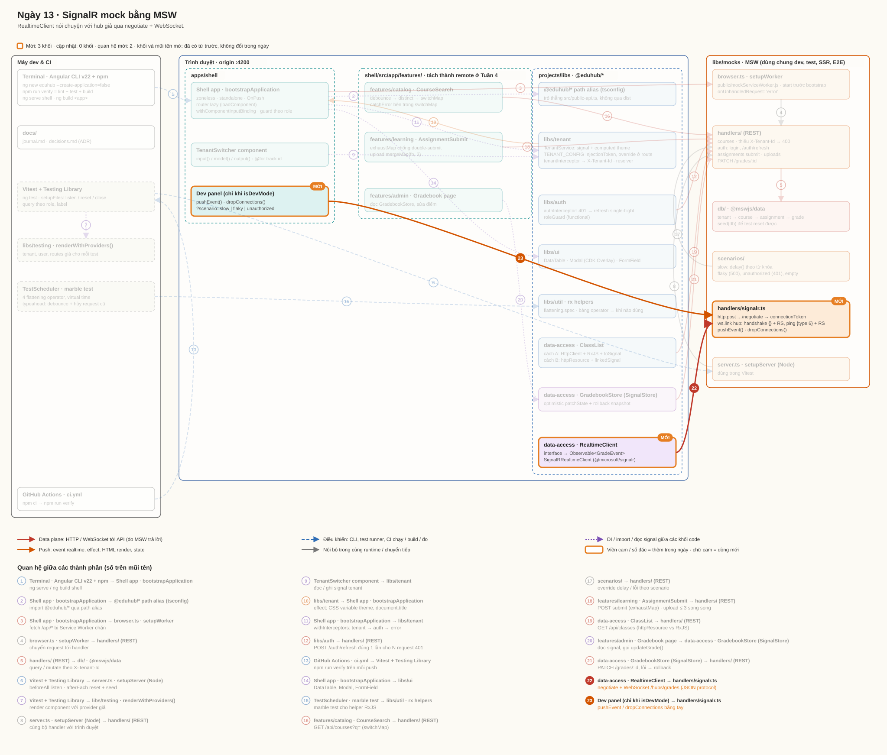](images/eduhub-day13.svg)

**Mục tiêu:** `@microsoft/signalr` kết nối được tới hub giả trong MSW, đi qua cả negotiate và handshake.

**Chú ý:**

- Negotiate: `http.post('*/hubs/grades/negotiate')` trả `connectionToken` và transport `WebSockets`.
- Hub: `ws.link('ws://*/hubs/grades')`. Mỗi message kết thúc bằng `\u001e`. Trả `{}` khi nhận handshake, ping `{"type":6}` định kỳ.
- Export helper `pushEvent(target, payload)` và `dropConnections()` cho test và dev panel.
- Chỉ dùng JSON protocol, không MessagePack. Đối chiếu API `ws.link` (`broadcast`, `clients`) với bản MSW đã cài.
- `RealtimeClient` là interface trả `Observable<GradeEvent>`. Component và store chỉ biết interface này.

**Lệnh:**

```bash
npm i @microsoft/signalr
# libs/mocks/src/handlers/signalr.ts
# libs/data-access/src/realtime/{realtime-client.ts,signalr-realtime-client.ts}
ng serve shell   # DevTools > Network > WS: thấy frame handshake và ping
```

**Xong khi:** gọi `pushEvent('gradeUpdated', …)` từ dev panel thì console của app log được event.

### Ngày 14 – Realtime vào store, reconnect, tổng kết (Chủ nhật 8/11, 3–4 giờ)

[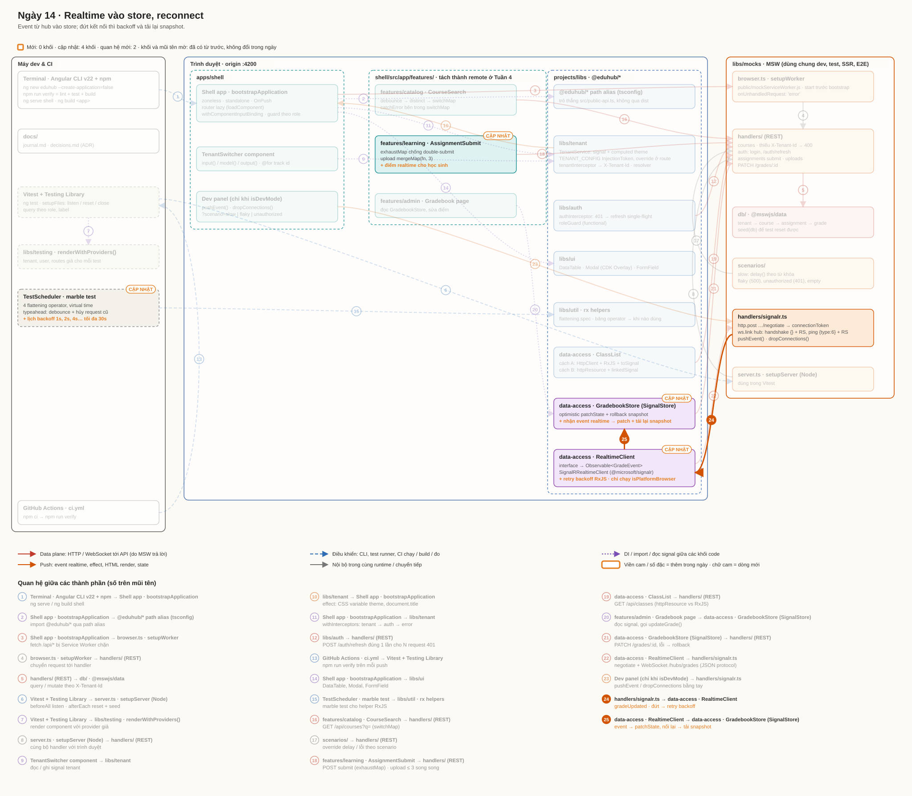](images/eduhub-day14.svg)

**Mục tiêu:** điểm cập nhật realtime trong UI, đứt kết nối thì tự nối lại với exponential backoff.

**Chú ý:**

- Chọn **một** nơi lo reconnect. Khuyên tắt `withAutomaticReconnect` và tự làm bằng RxJS `retry({ delay: (err, n) => timer(min(1000 * 2 ** n, 30000)) })` để test được bằng marble.
- Sau khi nối lại phải tải lại snapshot điểm, vì có thể đã lỡ event trong lúc mất kết nối.
- Không kết nối hub khi chạy trên server (để dành cho tuần 3): bọc bằng `isPlatformBrowser`.
- Kiểm tra leak: mở/đóng trang gradebook 10 lần, heap snapshot không tăng số `HubConnection`.

**Lệnh:**

```bash
ng test data-access --no-watch --coverage
git tag week-2 && git push --tags
```

**Xong khi:** (1) test `pushEvent` → ô điểm trên UI đổi; (2) `dropConnections()` → kết nối lại và nhận event tiếp; (3) marble test lịch backoff 1s, 2s, 4s… tối đa 30s; retro tuần 2.

## Tuần 3 – SSR, Hydration, Forms, Performance (9/11 – 15/11)

Cuối tuần: catalog SSR trả HTML có nội dung thật, không double-fetch, có số liệu Lighthouse trước/sau, form tạo bài kiểm tra có test và không lỗi a11y nghiêm trọng.

### Ngày 15 – App catalog SSR + MSW phía server (Thứ Hai 9/11)

[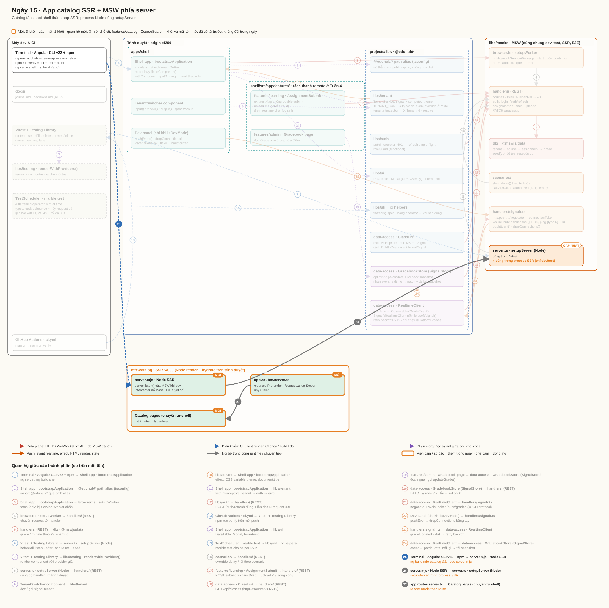](images/eduhub-day15.svg)

**Mục tiêu:** `mfe-catalog` chạy SSR, render danh sách khóa học từ MSW ngay trên server.

**Chú ý:**

- Request phía server không đi qua Service Worker. Gọi `server.listen()` của MSW trong `server.ts` khi chạy dev, tắt hẳn ở production build.
- `HttpClient` trên server cần URL tuyệt đối. Thêm interceptor nối base URL khi `isPlatformServer`.
- Khai báo render mode trong `app.routes.server.ts`: `/courses` dùng `Prerender`, `/courses/:slug` dùng `Server`, `/my` dùng `Client`.
- Chuyển feature catalog từ shell sang app này (đã tách thư mục từ tuần 2 nên chỉ là di chuyển).

**Lệnh:**

```bash
ng g application mfe-catalog --routing --style=scss --ssr
npx msw init projects/mfe-catalog/public --save
ng serve mfe-catalog
ng build mfe-catalog && node dist/mfe-catalog/server/server.mjs
curl -s http://localhost:4000/courses | grep -c "course-card"
```

**Xong khi:** `curl` (không chạy JS) trả về HTML có danh sách khóa học.

### Ngày 16 – Transfer cache, chống double-fetch (Thứ Ba 10/11)

[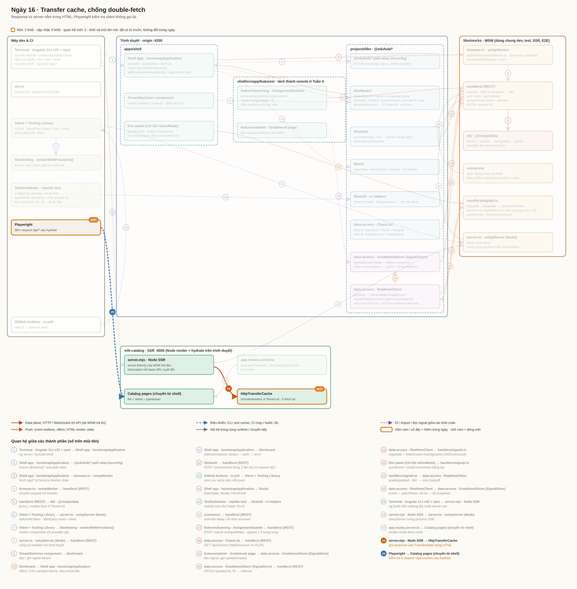](images/eduhub-day16.svg)

**Mục tiêu:** trang SSR chỉ gọi API **một lần**, client hydrate xong không gọi lại.

**Chú ý:**

- `provideClientHydration(withHttpTransferCacheOptions({ includeHeaders: [...] }))`. Mặc định chỉ cache GET/HEAD và bỏ qua request có header `Authorization`.
- Header `X-Tenant-Id` phải giống nhau giữa server và client, nếu không key cache lệch và client gọi lại.
- Kiểm tra thủ công: tab Network sau khi load trang không có request `/api/courses` nào.

**Lệnh:**

```bash
npm i -D @playwright/test && npx playwright install chromium
# e2e/catalog/transfer-cache.spec.ts: đếm request /api/* sau khi trang hydrate
npx playwright test e2e/catalog
```

**Xong khi:** test Playwright xác nhận 0 request `/api/courses` từ trình duyệt khi mở trang chi tiết lần đầu.

### Ngày 17 – SEO, meta, ảnh (Thứ Tư 11/11)

[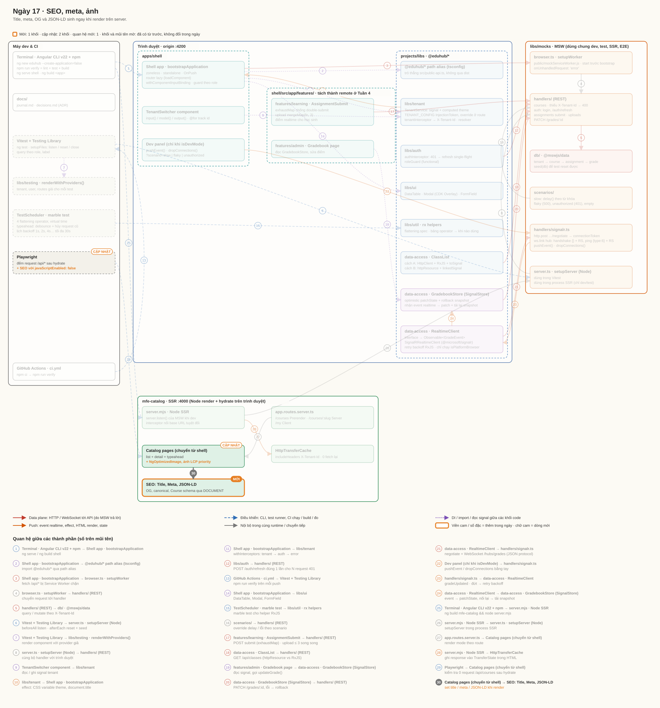](images/eduhub-day17.svg)

**Mục tiêu:** trang chi tiết khóa học có `<title>`, meta description, OG tag, canonical và JSON-LD `Course` động.

**Chú ý:**

- Dùng `Title`, `Meta` service và inject `DOCUMENT` để chèn `<script type="application/ld+json">`. Không đụng `window` trực tiếp.
- Ảnh dùng `NgOptimizedImage`, ảnh LCP đặt `priority`.
- Test SSR bằng Playwright với `javaScriptEnabled: false` để chắc chắn nội dung có sẵn trong HTML thô.

**Lệnh:**

```bash
npx playwright test e2e/catalog/seo.spec.ts
curl -s http://localhost:4000/courses/angular-signals | grep -E "<title>|og:title|ld\+json"
```

**Xong khi:** test SEO xanh với JS tắt, `curl` thấy đủ title, OG và JSON-LD.

### Ngày 18 – Hydration và `@defer` (Thứ Năm 12/11)

[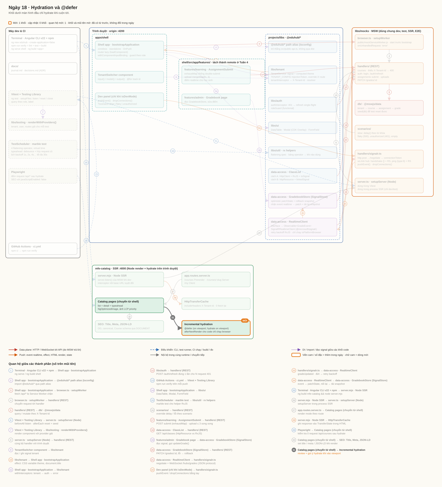](images/eduhub-day18.svg)

**Mục tiêu:** dùng incremental hydration cho phần review và khóa học liên quan, không còn lỗi hydration mismatch.

**Chú ý:**

- `provideClientHydration(withIncrementalHydration())`, rồi `@defer (on viewport; hydrate on viewport)` cho khối dưới màn hình đầu tiên.
- Code chỉ chạy trên trình duyệt (đo kích thước, `localStorage`, kết nối SignalR) đặt trong `afterNextRender`.
- Lỗi `NG0500`… trong console là mismatch giữa HTML server và DOM client. Nguyên nhân thường gặp: `Date.now()`, random, HTML không hợp lệ.

**Lệnh:**

```bash
npx playwright test e2e/catalog/defer.spec.ts
```

**Xong khi:** test Playwright: khối review chưa có trước khi cuộn, có sau khi cuộn; console không có lỗi `NG05xx`.

### Ngày 19 – Typed reactive forms (Thứ Sáu 13/11)

[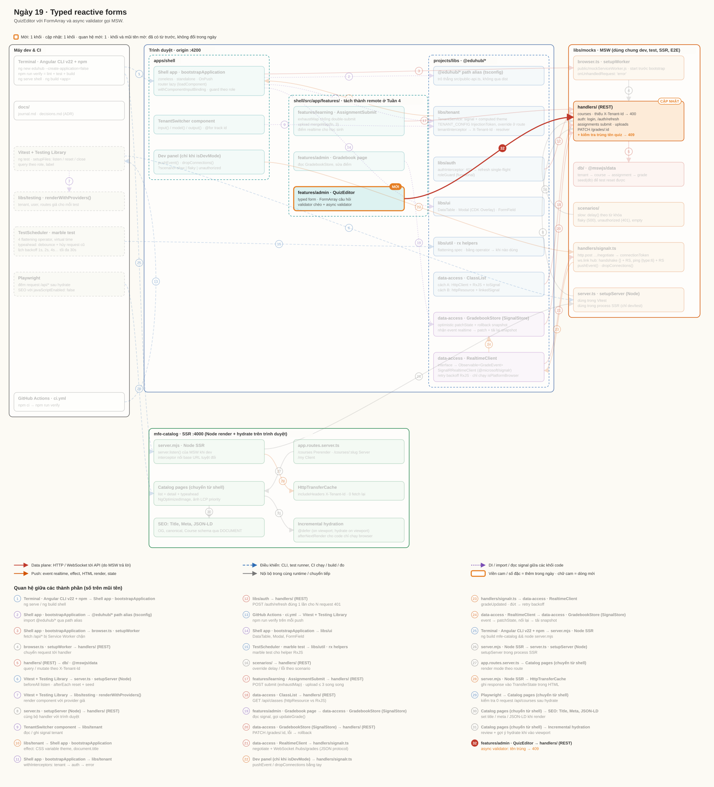](images/eduhub-day19.svg)

**Mục tiêu:** form tạo bài kiểm tra có `FormArray` câu hỏi động, validator chéo và async validator.

**Chú ý:**

- Dùng `NonNullableFormBuilder` để form có kiểu chặt, `getRawValue()` trả đúng type.
- Validator chéo: ngày hết hạn phải sau ngày mở, tổng điểm các câu bằng 100.
- Async validator kiểm tra trùng tên: MSW trả 409. Thêm `debounce` để không gọi API mỗi phím.
- Nếu muốn mở rộng: đọc Signal Forms (API mới, còn thử nghiệm) và ghi so sánh ngắn, không bắt buộc dùng.

**Lệnh:**

```bash
ng g component features/admin/quiz-editor --project=shell
ng test shell --no-watch
```

**Xong khi:** test: thêm/xóa câu hỏi, tổng điểm sai thì nút lưu bị khóa, tên trùng thì hiện lỗi từ async validator.

### Ngày 20 – ControlValueAccessor và a11y (Thứ Bảy 14/11, 3–4 giờ)

[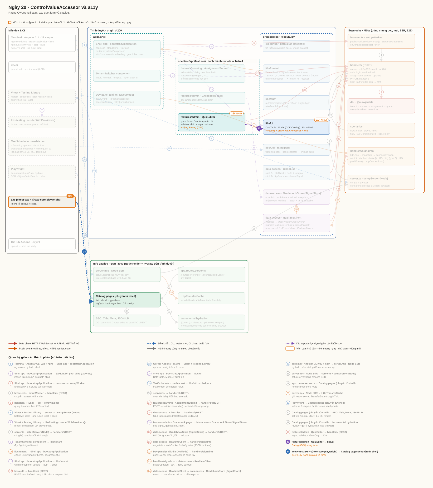](images/eduhub-day20.svg)

**Mục tiêu:** một control `Rating` (hoặc rich-text) dùng được với `formControl` lẫn `ngModel`, không lỗi a11y nghiêm trọng.

**Chú ý:**

- CVA cài đủ `writeValue`, `registerOnChange`, `registerOnTouched`, `setDisabledState`. Hay quên cái cuối.
- Dùng phím mũi tên để đổi giá trị, có `role="slider"` hoặc nhóm radio, có `aria-valuenow`.
- axe chạy ở cả 2 nơi: component test và Playwright.

**Lệnh:**

```bash
npm i -D vitest-axe @axe-core/playwright
ng g component rating --project=ui
ng test ui --no-watch
npx playwright test e2e/a11y
```

**Xong khi:** CVA có test với cả 2 kiểu form; axe không có lỗi `serious`/`critical` trên form và trang catalog.

### Ngày 21 – Performance và tổng kết (Chủ nhật 15/11, 3–4 giờ)

[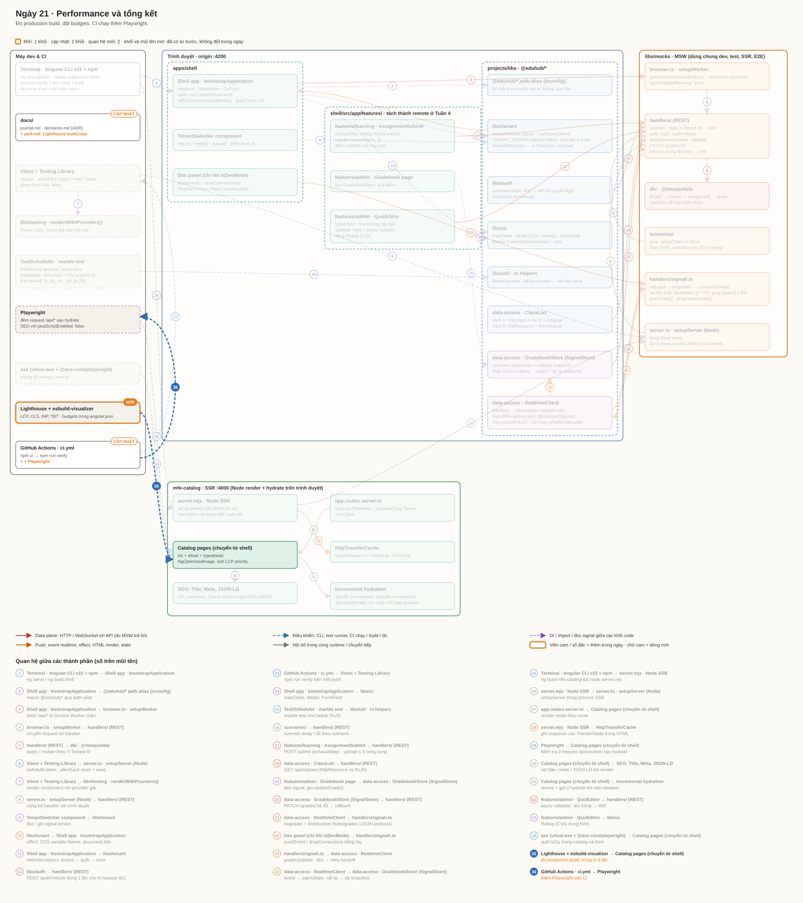](images/eduhub-day21.svg)

**Mục tiêu:** có số liệu trước/sau tối ưu cho catalog và shell.

**Chú ý:**

- Đo bản **production build**, mỗi lần đo 3 lần lấy trung vị, ghi LCP, CLS, INP, TBT và kích thước bundle ban đầu.
- Tối ưu theo thứ tự: lazy route → `@defer` → ảnh → bỏ thư viện nặng.
- Đặt `budgets` trong `angular.json` để build fail nếu bundle phình.

**Lệnh:**

```bash
ng build mfe-catalog --stats-json
npx esbuild-visualizer --metadata dist/mfe-catalog/stats.json --open
npx lighthouse http://localhost:4000/courses --preset=desktop --view
npx playwright test
git tag week-3 && git push --tags
```

**Xong khi:** `docs/perf.md` có bảng số liệu trước/sau và lý do của từng thay đổi; thêm Playwright vào CI; retro tuần 3.

## Tuần 4 – Micro Frontend + Capstone (16/11 – 22/11)

Cuối tuần: shell + 3 remote deploy độc lập, capstone "Live Gradebook & Course Catalog" chạy đủ luồng, CI xanh, README có quyết định thiết kế.

### Ngày 22 – Native Federation: shell và 2 remote (Thứ Hai 16/11)

[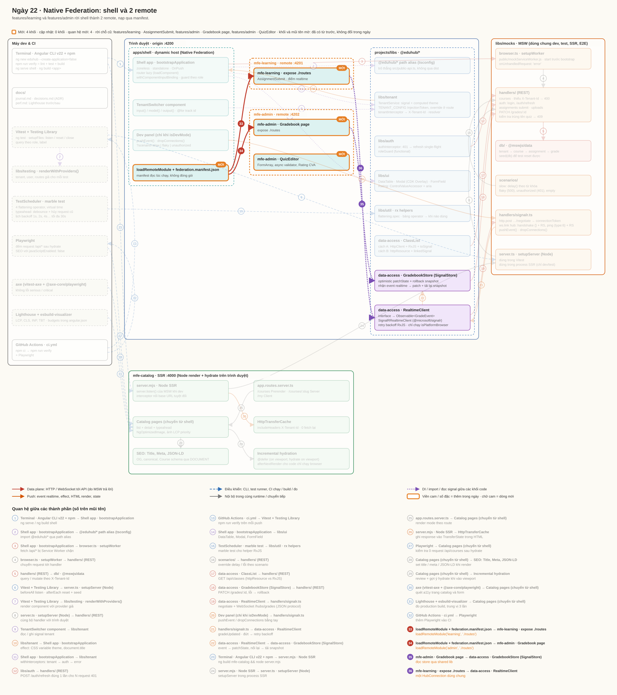](images/eduhub-day22.svg)

**Mục tiêu:** shell là dynamic host, `mfe-learning` và `mfe-admin` là remote, load qua manifest.

**Chú ý:**

- Tag `pre-mfe` trước khi chạy schematic, vì nó sửa `angular.json`, `main.ts` và thêm `bootstrap.ts`.
- Cài đúng major của Native Federation khớp với Angular.
- Remote expose **routes** (`./routes`), không expose từng component. Shell dùng `loadChildren` + `loadRemoteModule`.
- Chuyển `features/learning` và `features/admin` từ shell sang 2 app mới.

**Lệnh:**

```bash
ng g application mfe-learning --routing --style=scss --ssr=false
ng g application mfe-admin --routing --style=scss --ssr=false
npm i -D @angular-architects/native-federation
ng g @angular-architects/native-federation:init --project shell --port 4200 --type dynamic-host
ng g @angular-architects/native-federation:init --project mfe-learning --port 4201 --type remote
ng g @angular-architects/native-federation:init --project mfe-admin --port 4202 --type remote
# chạy 3 terminal
ng serve mfe-learning
ng serve mfe-admin
ng serve shell
```

**Xong khi:** từ `localhost:4200` điều hướng được sang `/learning` và `/admin`, tab Network thấy `remoteEntry.json` của từng remote.

### Ngày 23 – Shared dependencies và state dùng chung (Thứ Ba 17/11)

[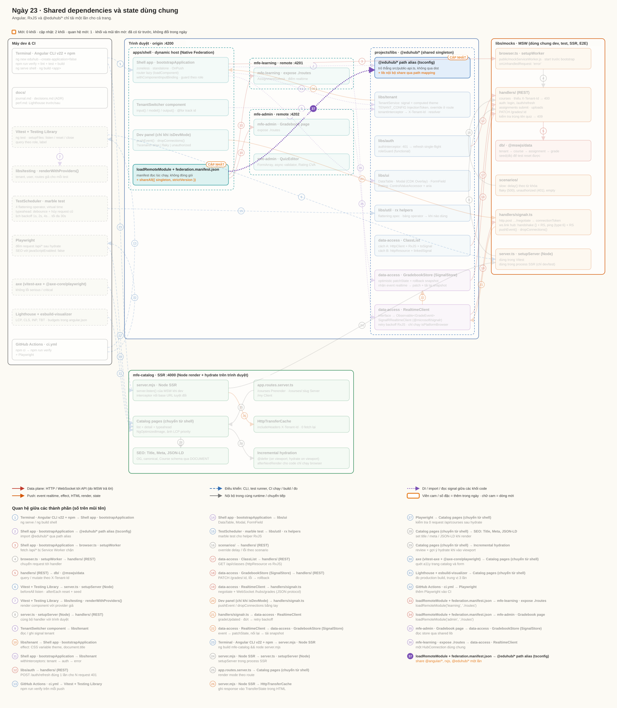](images/eduhub-day23.svg)

**Mục tiêu:** Angular, RxJS, `@eduhub/auth`, `@eduhub/tenant` chỉ tải **một lần**; đổi tenant ở shell thì remote cập nhật.

**Chú ý:**

- `shareAll({ singleton: true, strictVersion: true, requiredVersion: 'auto' })`. Lib nội bộ được share qua path mapping trong `tsconfig`.
- Service phải là singleton thật trên toàn trang. Nếu thấy 2 instance `TenantService`, kiểm tra lib đã được share chưa.
- Thử cố ý lệch version một package giữa shell và remote, ghi lại lỗi và cách nhận ra.
- So sánh 2 cách chia sẻ state: signal service trong shared lib và `CustomEvent` trên `window`. Ghi ADR.

**Lệnh:**

```bash
ng build shell && ng build mfe-learning
# kiểm tra trong DevTools > Network: chỉ 1 file @angular/core
```

**Xong khi:** Playwright test: đổi tenant `alpha` → `beta` ở shell, header và dữ liệu trong `mfe-learning` đổi theo.

### Ngày 24 – Cô lập lỗi và deploy độc lập (Thứ Tư 18/11)

[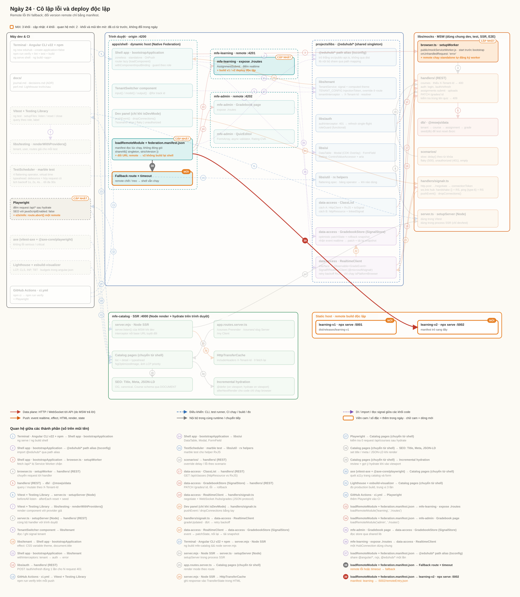](images/eduhub-day24.svg)

**Mục tiêu:** một remote chết thì shell hiện fallback; đổi version remote chỉ bằng cách sửa manifest.

**Chú ý:**

- Bọc `loadRemoteModule` bằng `catch` trả về route fallback. Đặt thêm timeout để remote treo không làm shell treo.
- Remote chạy **standalone** (ngoài shell) là origin khác nên tự đăng ký MSW worker. Chạy trong shell thì worker của shell bắt request.
- Manifest (`public/federation.manifest.json`) đọc lúc chạy, không đóng gói vào bundle của shell.

**Lệnh:**

```bash
ng build mfe-learning --output-path=dist/releases/learning-v1
ng build mfe-learning --output-path=dist/releases/learning-v2   # sau khi sửa 1 dòng UI
npx serve dist/releases/learning-v1/browser -l 5001 --cors
npx serve dist/releases/learning-v2/browser -l 5002 --cors
# sửa manifest của shell: learning -> http://localhost:5002/remoteEntry.json, reload
npx playwright test e2e/mfe
```

**Xong khi:** test (1) `page.route('**/4202/**', r => r.abort())` → shell hiện fallback, `/learning` vẫn dùng được; (2) đổi manifest sang v2 thì thấy UI mới mà không build lại shell.

Nếu `mfe-catalog` (SSR) gây xung đột khi gắn Native Federation, giữ nó là app SSR độc lập. Thực tế site công khai cần SEO thường tách khỏi app sau đăng nhập; ghi điều này vào ADR.

### Ngày 25 – Capstone 1: luồng realtime xuyên MFE (Thứ Năm 19/11)

[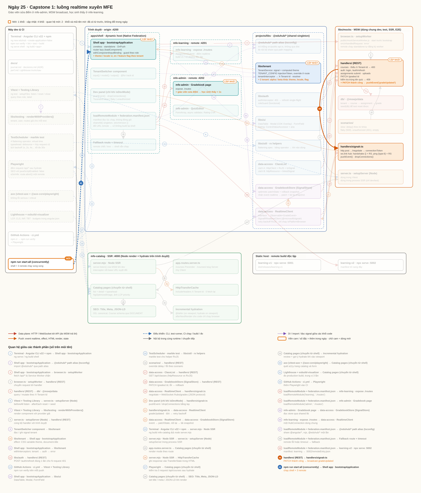](images/eduhub-day25.svg)

**Mục tiêu:** giáo viên sửa điểm trong `mfe-admin`, học sinh thấy điểm mới trong `mfe-learning` mà không reload.

**Chú ý:**

- MSW hub: khi `PATCH /grades/:id` thành công thì handler gọi `pushEvent('gradeUpdated', …)`. Đây là chỗ MSW đóng vai backend thật.
- 2 tenant phải khác nhau về theme, locale (`vi` và `en`) và ít nhất 1 feature flag.
- Chỉ một `HubConnection` cho cả trang, đặt trong shared lib.

**Lệnh:**

```bash
npm run start:all   # script chạy song song shell + 3 remote (dùng concurrently)
```

**Xong khi:** mở 2 cửa sổ (giáo viên, học sinh), sửa điểm ở cửa sổ 1 thì cửa sổ 2 đổi trong dưới 1 giây.

### Ngày 26 – Capstone 2: E2E luồng chính và luồng lỗi (Thứ Sáu 20/11)

[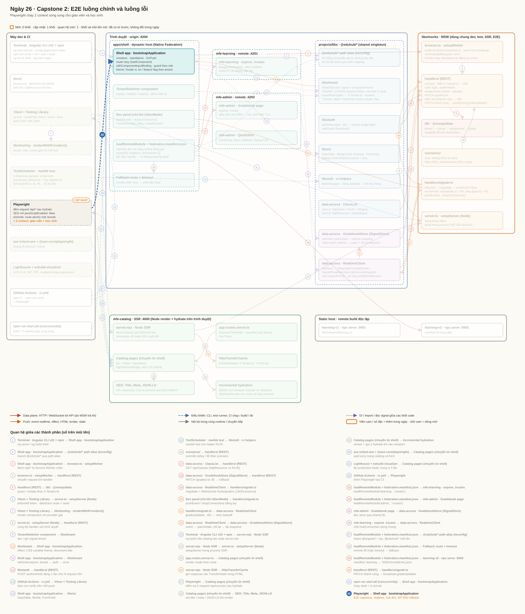](images/eduhub-day26.svg)

**Mục tiêu:** E2E chứng minh luồng realtime và hai kịch bản lỗi.

**Chú ý:**

- Dùng 2 `browser.newContext()` trong cùng một test để có giáo viên và học sinh song song.
- Kịch bản lỗi dùng scenario MSW (`?scenario=flaky`) hoặc `worker.use(...)` qua `page.evaluate`.
- Không `waitForTimeout`. Chờ theo trạng thái UI (`expect(locator).toHaveText`).

**Lệnh:**

```bash
npx playwright test e2e/capstone --repeat-each=5   # bắt test flaky
npx playwright show-report
```

**Xong khi:** 3 test xanh 5/5 lần: sửa điểm → học sinh thấy; hub đứt → nối lại → nhận event tiếp; PATCH 500 → rollback + thông báo.

### Ngày 27 – Capstone 3: chất lượng (Thứ Bảy 21/11, 3–4 giờ)

[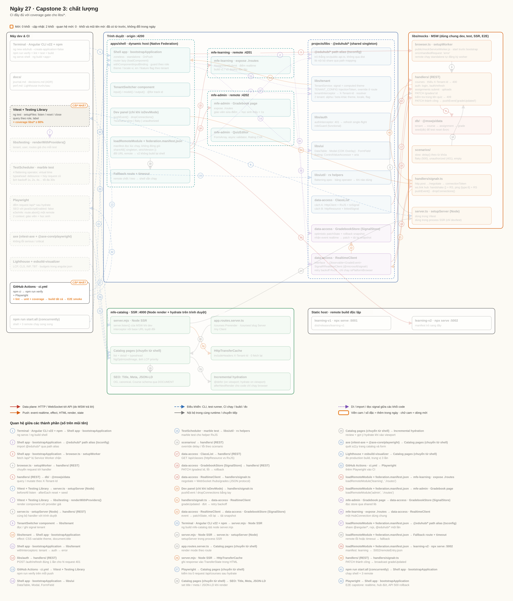](images/eduhub-day27.svg)

**Mục tiêu:** đạt toàn bộ ngưỡng chất lượng bắt buộc.

**Chú ý:**

- Coverage chỉ ép cho `libs/*`, không ép cho app.
- Tự làm mutation test bằng tay: đổi `exhaustMap` thành `mergeMap`, bỏ rollback, bỏ `track`. Test phải đỏ; nếu vẫn xanh thì test đó chưa đủ.
- CI đầy đủ: lint → unit + coverage → build tất cả → Playwright smoke.

**Lệnh:**

```bash
ng test --no-watch --coverage
npx playwright test
npx lighthouse http://localhost:4000/courses --preset=desktop --view
npm run verify
```

**Xong khi:** checklist trong Phụ lục "Definition of Done của capstone" được tick hết.

### Ngày 28 – Tài liệu, tự chấm, demo (Chủ nhật 22/11, 3–4 giờ)

[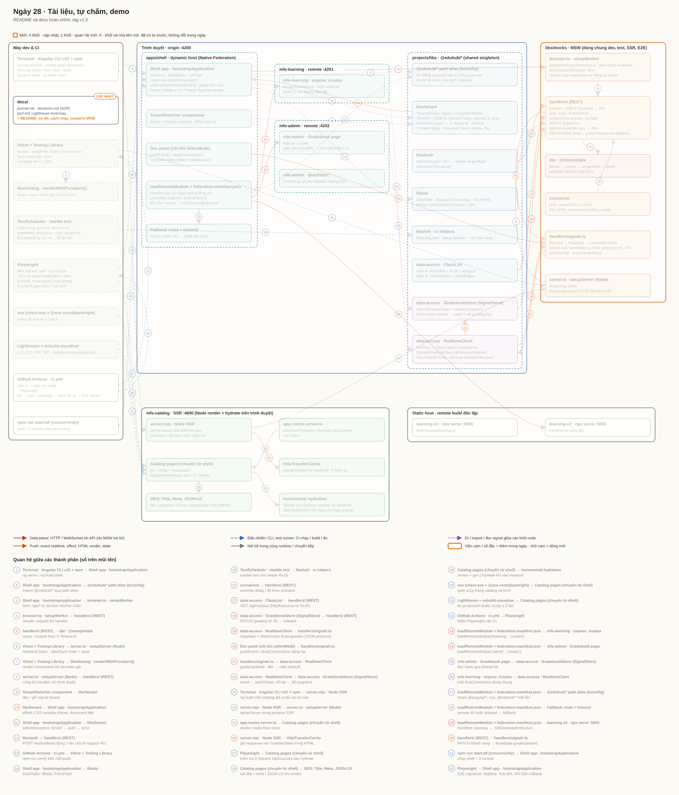](images/eduhub-day28.svg)

**Mục tiêu:** README đủ để người khác clone và chạy trong 5 phút, và bạn tự trình bày được kiến trúc trong 10 phút.

**Chú ý:**

- README: sơ đồ kiến trúc, cách chạy, danh sách scenario MSW, link tới `docs/decisions.md` và `docs/perf.md`.
- Quay video demo 3 phút hoặc tập nói thành tiếng 1 lần, như đang trình bày trong phỏng vấn.
- Chấm điểm theo bảng tự chấm, mục nào dưới 3 thì ghi việc cần làm tiếp.

**Lệnh:**

```bash
git tag v1.0 && git push --tags
```

**Xong khi:** đã tag `v1.0`, có bảng tự chấm và retro cả tháng.

## Phụ lục

### Lệnh hay dùng

| Việc | Lệnh |
| --- | --- |
| Chạy shell | `ng serve shell` |
| Chạy tất cả (Tuần 4) | `npm run start:all` |
| Test một project | `ng test <project> --no-watch` |
| Test + coverage | `ng test <project> --no-watch --coverage` |
| Test chỉ một file | `ng test <project> --include=**/gradebook.store.spec.ts` |
| E2E | `npx playwright test` · `npx playwright test --ui` |
| E2E tìm flaky | `npx playwright test --repeat-each=5` |
| Build SSR và chạy | `ng build mfe-catalog && node dist/mfe-catalog/server/server.mjs` |
| Xem bundle | `ng build <app> --stats-json` rồi `npx esbuild-visualizer --metadata dist/<app>/stats.json --open` |
| Lighthouse | `npx lighthouse <url> --preset=desktop --view` |
| Cập nhật Angular | `ng update @angular/core @angular/cli` |
| Kiểm tra trước commit | `npm run verify` |

### Scenario MSW

| Scenario | Bật bằng | Dùng để kiểm tra |
| --- | --- | --- |
| `happy` | mặc định | Luồng bình thường |
| `slow` | `?scenario=slow` | Loading state, race condition, timeout |
| `flaky` | `?scenario=flaky` | Retry, rollback, thông báo lỗi |
| `unauthorized` | `?scenario=unauthorized` | Refresh token, chuyển về trang đăng nhập |
| `empty` | `?scenario=empty` | Empty state |
| Hub đứt | `dropConnections()` | Reconnect, tải lại snapshot |

### Definition of Done của capstone

- [ ] Shell + 3 remote, mỗi remote build và deploy độc lập, đổi version bằng manifest
- [ ] 2 tenant khác nhau về theme, locale và feature flag
- [ ] Catalog SSR: HTML thô có nội dung, title, OG, JSON-LD; không double-fetch
- [ ] Gradebook realtime qua SignalR mock, có reconnect + backoff và tải lại snapshot
- [ ] SignalStore, không `subscribe()` thủ công trong component, không NgModule, zoneless
- [ ] Form tạo bài kiểm tra: `FormArray`, validator chéo, async validator, CVA
- [ ] Ít nhất 2 marble test (typeahead, backoff)
- [ ] E2E: luồng realtime 2 người dùng, hub đứt, API 500 rollback; xanh 5/5 lần
- [ ] E2E MFE: remote chết, shell không sập
- [ ] axe: không lỗi `serious`/`critical` trên các trang chính
- [ ] Coverage `libs/*` ≥ 80%, CI xanh
- [ ] README, `docs/decisions.md`, `docs/perf.md`, `docs/journal.md` đầy đủ

### Bảng tự chấm (1–5)

| Tiêu chí | 5 điểm khi | Điểm |
| --- | --- | --- |
| Kiến trúc | Ranh giới MFE rõ, không import chéo giữa remote, shared lib có lý do |  |
| RxJS/Signals | Chọn operator giải thích được, không leak, không subscribe tay |  |
| SSR/hydration | Không mismatch, không double-fetch, render mode hợp lý theo route |  |
| Chiến lược test | Đúng tầng, test hành vi, mutation tay làm test đỏ, không flaky |  |
| Độ tin cậy của mock | Một nguồn handler, có scenario lỗi/chậm, hub mock đi qua negotiate + handshake |  |
| Performance | Có số liệu trước/sau, có budget trong build |  |
| Tài liệu | ADR nêu rõ vì sao chọn cách này thay vì cách kia |  |

### Nguồn tham khảo

- [Native Federation trên npm](https://npmjs.com/package/@angular-architects/native-federation): lệnh `init` cho host và remote
- [Micro Frontends with Modern Angular – Angular In Depth](https://angularindepth.com/article/micro-frontends-with-modern-angular-part-1-standalone-and-esbuild/)
- [Lịch phát hành Angular](https://versionlog.com/angular/): v22 là bản major hiện hành
